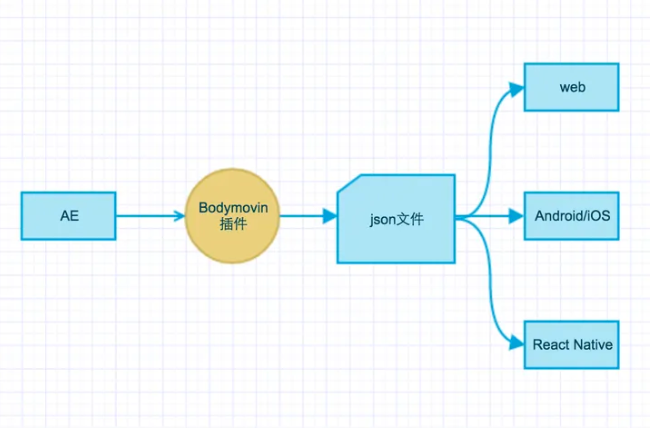

<div align="center">
<h1>lottie4cj</h1>
</div>

<p align="center">


</p>

## 介绍

lottie4cj是一个动画库，它可以解析Adobe After Effects软件通过Bodymovin插件导出的json格式的动画，并在移动设备上进行本地渲染。

### 特性

- 🚀 支持播放动画/播放动画片段

- 💪 支持控制动画播放/暂停/停止

- 🛠️ 支持设置播放速度

- 🌍 支持设置动画播放方向

- 💡 支持获取动画时长/帧数

## 软件架构

### 架构图

<p align="center">

</p>

### 源码目录

```shell
├── README.md              #整体介绍
├── doc                    #文档目录
│   ├── assets             #文档资源目录
│   └── feature_api.md     #API接口文档
├── src                    #源码目录
└── test                   #测试代码目录
```

### 接口说明

主要类和函数接口说明详见 [API](./doc/feature_api.md)


## 使用说明

### 编译构建

具体的编译过程：

拉取代码后执行命令
```shell
cjpm update
cjpm build
```

### 功能示例
#### 动画json数据解析 功能示例

功能示例描述:      
将动画json数据读取转为字符串，解析成AnimationData格式。

示例代码如下：

```cangjie
public import std.fs.*
public import std.sync.*

public import lottie4cj.parser.*
public import lottie4cj.model.*

main (){

    var sum: Int64 = test_01()
    if (sum != 0) {
        return sum
    }
    println("数据解析成功")

    return 0
}

func test_01(): Int64 {
    let filename: String = "benchmark.json"
    let str: String = readFile(filename)

    let data: AnimationData = AnimationDataParser.parse(str)
    let assets: Array<Asset> = data.assets
    let assets0: Asset = assets[0]

    if(assets.size != 1 || assets0.id != "image_0" || assets0.w != 80 || assets0.h != 80) {
        return -1
    }
    let p: String = "data:image/png;base64,iVBORw0KGgoAAAANSUhEUgAAAFAAAABQCAYAAACOEfKtAAAACXBIWXMAAAABAAAAAQBPJcTWAAAAJHpUWHRDcmVhdG9yAAAImXNMyU9KVXBMK0ktUnBNS0tNLikGAEF6Bs5qehXFAAAF8klEQVR4nO2ca6gUZRjHf8+e3ZnxqKWB2IUQ6oNiH7qIGZUXJKhMU7tKUJEoRdKHLnQhwuiDaPVRKyqV/FKJWWIpGAhSQtgpi1LRJCIqKsGCTOed3ZmnD3sU252dM7s7M3vGMz84LLyX5/3v/8zMe52FgoKCgoKCgoJcIkkFUrAol6dTLk9F9QpEJgI+8CNBcAj4RjzvUFLtRWoZNepSfH8aMAWYQqnkoPoXcBCRQ7jugMDfSbTVlYE6ZswEPG85IjcC1wATh6jyHar7Edkixmzvpu0mLZXKdEqlB1G9GpHrgFJE8X+AL4EBYIMYc7jTdjsyUPv7L8b3XwSWAGM7a1n2obpJjFnXUf3TWixrISIPA7d2EWYrQbBGqtV97VZs20C1rJWIPAWMabduC/YSBE+0K15Hj55IrbYOuDMhHQBvY8yjAtW4FWIbqDAWx9mK6k2daRuqAX1OPG91rKKWdRcibwHjUlBylCC4R6rV/XEKxzJQ4RJsey8ik1DtTl4068WYZZFaLOtpRNakKQKRGrXazVKr7R6y6FAFFM7DcQ4Cl6Rs3qAieV9cd0moFsd5AdWXMtBQ//T96VKtDkQVjeqp6ljWLrIyD0D1XrXtN5qSK5VHMjGvrqH+WSrtVjg/qmikgdrfvxKYkZl5pxF5WG17xRkdlcp19PW9nqmG+ncei+O8F1Ws5S2sMAnb/ilZVW1iTL/AKXWc48D4zP+Rp6nV5onv7wzLKresZFmvpiYoLqNGbVY4gmrvzAMol9fi+5eHZYVegQoXYtu/AH2pCssLIlCtLhLf39aYFf4MtKzHESnMO5tyeXlYcqtOZFZPb5nhRt2LGxQqjVlNBiqMR2RaFrpyxjhs+5bGxOYr0LJmE+J0AQBzGhPCbuEr09eRU0QuakxqNlDk0jNTmYL/o9q0AhVm4JiiA2mJ1Zgw9Fy4IJJmA4Mg9mLiCMRvTAi7hU9kIiWfeI0JYQb+mYmUPCLyb2NSs4Gqv2ciJo+onmpMCutEjmYgJX+IhF5czQb29R3IRFA+afKmyUA5efI34EgmcvKEKpRKXzQmtxoH/pCynDxyWFz3p8bEcANVDxXTubOoP/8OhmW1ugI3FdO5BkT2hCa3Kq+WdYBSaWphJAAuxkwQaJpkRM2Ft6QoKD/UH2W7wsyD6G3Nsdj2McBOSVp+8P1ZUqt9FpbV8gqU+hm6d0Z0Z1LvPL5sZR4McTZG6/sAx4jaPz7X8f2ZUqt93io7cj1w8Bjss4mLyg8fRJkHcY+32fZX1I/wjiROYMxEgZNRheKtSBuzAJGRM54RAd+/YyjzIKaBAr8RBItHUIeySmq1T+MUjL0nIp63jSBYOQJM3Cqu+3zcwu0fMrftNxFZfs7NUOpDlr1izI1tVeukLbWsDYg81EndYYvIPlz3BoFaW9U6bU8dZzOqd3daf5ixH2NmtZquRdHxvrC47j2IvNtp/WGDyADGzOzEPOhyY11c9z5gfY47lj247kyBpt22uHR9MkGMWYbqK93GyRzVbWLMHAG3mzCJHO0QY55G9ZkkYmWC6kbxvEVJhErsbIx43suo3p9UvNQQWSWetzSxcEkFOo06zlxUdzAc1xGDYIVUq68lGTKVp7/a9mTgEyD01YAe4AOLxJiPkw6cWvepcAGOsxPVa9NqIyZ/EATzpFr9Oo3gqZ0PFDgurjsD1Y/SaiMG31IqTUvLPMjggKV43mJgbdrthLADY66VU6d+TbORTE6oijGPZTzMWS/G3CYh5/mSJtMphFrW3YhsTrcRXSmel81rsWRsIICWy9fT1/cJabyuHwRLpVrdmHjcCHoyiVXHuWxwrDg5oZAucLsYE2sVOUl6tgow+FMCH6I6t8tQP6N6m3je94kIa5OeL6OobW8H5ndY/eDgUtTxJDW1Q8/fExFjFqDayXPrM4y5qpfmDSvUcVarbWvMv14OzocvattPDmmeZa3vtc5hjVYqD0QYmL+F216glrUw5MqLvVdbAGi5PPssAx/ttZ5corY9/+wf4CkoKCgoKCgoKEiM/wDSaB3QR6Qn0wAAAABJRU5ErkJggg=="

    if(assets0.p != p || assets0.u != "") {
        return -2
    }
    if(assets0.layers.size != 0) {
        return -3
    }
    if(assets0.toString() == "") {
        return -4
    }
    return 0
}

func readFile(path: String): String {
    let file: File = File(path, OpenOption.Open(true, true))
    let len: Int64 = file.length
    var buf: Array<Byte> = Array<Byte>(len, item: 0)
    file.read(buf)
    file.close()

    return String.fromUtf8(buf)
}
```

执行结果如下：

```shell
数据解析成功
```

## 约束与限制
暂无

## 开源协议
本项目基于 [The MIT License](./LICENSE)，请自由的享受和参与开源。

## 参与贡献

欢迎给我们提交PR，欢迎给我们提交Issue，欢迎参与任何形式的贡献。
