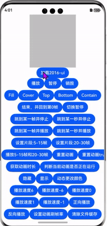

<div align="center">
<h1>lottie4cj</h1>
</div>

<p align="center">


</p>

## 介绍

lottie4cj是一个动画库，它可以解析Adobe After Effects软件通过Bodymovin插件导出的json格式的动画，并在移动设备上进行本地渲染。

### 效果展示


### 特性

- 🚀 支持加载本地文件方式加载动画
- 🚀 支持加载网络资源以URI路径方式加载动画,支持json和zip/gzip格式,gzip格式只能是单json文件压缩，且结尾为.tar.gz或者.gz
- 🚀 支持构建animationData对象加载动画
- 🚀 支持动画播放、暂停、销毁等功能

## 软件架构

### 源码目录

```shell
/lottie4cj                   # 项目根目录
├── doc                      #文档目录
│   ├── assets               #文档资源目录
│   └── feature_api.md       #API接口文档
├── entry                    # 示例代码文件夹
├── lottie                   # lottie库文件夹
│    └─ src/main/cangjie/src # 核心代码，包含json解析，动画绘制，操作动画                  
├── README.md                # 安装使用方法      
```

### 接口说明

主要类和函数接口说明详见 [API](./doc/feature_api.md)

### 编译构建

1.module方式引入

1. 克隆下载项目
2. 将 lottie 模块拷贝到应用项目下
3. 修改自身应用 entry 下的 oh-package.json5 文件，在 dependencies 字段添加 "lottie": "file:../lottie"
```shell
{
  "name": "entry",
  "version": "1.0.0",
  "description": "Please describe the basic information.",
  "main": "",
  "author": "",
  "license": "",
  "dependencies": {
    "lottie": "file:../lottie"
  }
}
```
4. 修改自身应用 entry/src/main/cangjie 下的 cjpm.toml 文件，在 [dependencies] 字段下添加 lottie = {path = "../../../../lottie/src/main/cangjie", version = "1.0.0"}
```shell
[dependencies]
lottie = {path = "../../../../lottie/src/main/cangjie", version = "1.0.0"}
```
5. 在项目中引用
```cangjie
  import lottie.*
```

2.三方库方式引入
1. 目标工程把 lottie4cj 依赖库作为 git submodule 引入
```
> cd $工程根目录
> mkdir third-party
> cd third-party
> git submodule add "https://gitcode.com/Cangjie-TPC/lottie4cj.git"
```
2. 修改自身应用 entry/src/main/cangjie 下的 cjpm.toml 文件，添加依赖
```
[dependencies]
lottie = {path = "../../../../third-party/lottie4cj/lottie/src/main/cangjie", version = "1.0.0"}
```
3. 在项目中引用
```cangjie
import lottie.*
```

## 使用说明

前提：数据准备

lottie动画文件是由设计人员使用Adobe After Effects软件通过bodymovin插件导出json格式的文件。

AE（Adobe After Effects）软件创建动画时需要设置动画的宽(w)、高(h)、bodymovin插件的版本号(v)、帧率(fr)、开始帧(ip)、
结束帧(op)、静态资源信息(assets)、图层信息(layers)等重要信息。

如果仅是用于demo测试，可以使用[工程示例中的json文件](https://gitcode.com/Cangjie-TPC/lottie4cj/tree/develop/entry/src/main/resources/rawfile) 。

1.在相应的类中引入组件：

```
internal import lottie.animation.*
internal import lottie.utils.helpers.*
internal import lottie.model.*
```

2.构建渲染上下文

```
var mainRenderingSettings: RenderingContextSettings = RenderingContextSettings(antialias: true)
var mainCanvasRenderingContext: CanvasRenderingContext2D = CanvasRenderingContext2D(this.settings)
```

3.將动画需要的json文件放到resources/rawfile目录下，然后引用。(json路径为entry/src/main/resources/rawfile/data.json)

注意：json文件路径不能使用 ./ 或者 ../ 等相对路径，相对路径获取不到动画源数据，会导致动画加载不出来, 传递给loadAnimation 方法的路径是相对于resources/rawfile文件夹为基准的。

```
  let path: String = "data.json"
  let animationData: AnimationData = AnimationDataParser.parse(String.fromUtf8(loadMedia(path,globalAbilityContext)))
```

4.关联画布

```
Canvas(this.mainCanvasRenderingContext).width(45.percent).height(200).backgroundColor(Color.GRAY)
.onReady({ =>
    //抗锯齿的设置
    this.mainCanvasRenderingContext.imageSmoothingEnabled(true)
    this.mainCanvasRenderingContext.imageSmoothingQuality(QualityType.Medium)
})
```
注意：canvas设置的宽高比例建议和动画json资源里面的宽高比例一致，如：json动画资源里的宽高比例是 1:2 ，则canvas设置的宽高也是 1:2
- 想要的抗锯齿效果：mainCanvasRenderingContext.imageSmoothingEnabled(true) 与 mainCanvasRenderingContext.imageSmoothingQuality(QualityType.Medium)

- 动画绘制前会对canvas画布进行清空处理，画布清空后再绘制动画。

5.加载动画

- 加载动画的时机需要注意，点击按钮加载动画可按照正常逻辑放在点击事件内，如果想要实现进入页面自动播放动画，需要结合Canvas组件的onReady()生命回调周期实现，加载动画时机需放置在onReady()生命周期回调内或及之后。
- 同一Canvas组件加载多次/不同动画资源，需要手动销毁动画(lottie.destroy("2016"))，之后才可再次加载其他动画资源。
```      
    lottie.destroy(animationName："2016") //加载动画前先销毁之前加载的动画
    this.lottie: AnimationManager = AnimationManager(this.mainCanvasRenderingContext)
    this.animateItem = lottie.loadAnimation(AnimationConfig(
        container: this.mainCanvasRenderingContext,              // 渲染上下文
        renderer: "canvas",                                      // canvas 渲染模式
        loop: -1,                                                // 是否循环播放,默认 -1 循环。
        autoplay: true,                                          // 是否自动播放，默认true
        name: "2016",                                            // 动画名称
        contentMode: "Contain",                                  // 填充的模式
        animationData: animationData,                            // json动画解析的对象
        context: globalAbilityContext
    ))
    或  
    this.animateItem = lottie.loadAnimation(AnimationConfig(
        container: this.mainCanvasRenderingContext,       // 渲染上下文
        renderer: "canvas",                               // canvas 渲染模式
        loop: -1,                                         // 是否循环播放,默认 -1 循环。
        autoplay: true,                                   // 是否自动播放，默认true
        name: "2016",                                     // 动画名称
        contentMode: "Contain",                           // 填充的模式
        path: "data.json",                                // 路径加载动画支持：1.raw文件夹下的相对路径和本地路径，2.本地路径要配合 pathSourceFrom 参数使用。
        context: globalAbilityContext
    ))
    或      
    this.animateItem = lottie.loadAnimation(AnimationConfig(
        container: this.mainCanvasRenderingContext,              // 渲染上下文
        renderer: "canvas",                                      // canvas 渲染模式
        loop: 1,                                                 // 是否循环播放,默认 -1 循环。
        autoplay: true,                                          // 是否自动播放，默认true
        name: "2016",                                            // 动画名称
        contentMode: "Contain",                                  // 填充的模式
        path: "/data/storage/el2/base/files/entry/data.json",    // 路径加载动画支持：1.raw文件夹下的相对路径和本地路径，2.本地路径要配合 pathSourceFrom 参数使用。
        pathSourceFrom: 2,                                       // 区别json文件来源：1.来自\resources\rawfile\， 2.来自手机中保存的json。（不填默认 1）
        context: globalAbilityContext
    ))
    或      
    this.animateItem = lottie.loadAnimation(AnimationConfig(
        uri: "https://assets7.lottiefiles.com/packages/lf20_sF7uci.json",  //来自网络路径的动画数据，支持json和zip/gzip格式,gzip格式只能是单json文件压缩，且结尾为.tar.gz或者.gz
        isNetwork: true,                                                   //true优先读取网络资源,false优先读取本地缓存资源,默认 false。
        container: this.mainCanvasRenderingContext,                        // 渲染上下文
        renderer: "canvas",                                                // canvas 渲染模式
        autoplay: true,                                                    // 是否自动播放，默认true
        name: "2016",                                                      // 动画名称
        contentMode: "Contain",                                            // 填充的模式
        context: globalAbilityContext
    ))
```

- 加载动画时，animationData 参数、path 参数和 uri 参数，三者选其一。
- 动画来源加载优先级：1.animationData 参数；2.path 参数；3.uri 参数。
- animationData 参数：可结合ResourceManager进行读取资源文件内容进行设置，调用AnimationDataParser.parse 进行解析。
- path 参数：1. 支持加载entry/src/main/resources/rawfile/ 文件夹下的相对路径，不支持跨包查找文件；2. 支持加载沙箱中的路径，但要配合参数 pathSourceFrom 使用方可生效。
- pathSourceFrom 参数：表示json文件地址：1. rawfile下的对应资源；2. 沙箱路径中的对应资源。（默认为来源 1）
- uri 参数：支持加载网络资源以URI路径方式加载动画，该方式需申请 ohos.permission.INTERNET，ohos.permission.GET_NETWORK_INFO两个权限。
- 加载外部资源图片：应用默认读取rawfile下的对应资源图片，如果设置 pathSourceFrom 参数，则会根据参数值读取对应资源图片。

6.控制动画

- 播放动画

  ```
  lottie.play(animationName!: String = "") //所有动画播放
  或
  animationItem.play(name!: String = "") //当前指定animationItem动画播放
  ```

- 停止动画

  ```
  lottie.stop(animationName!: String = "") //所有动画停止
  或
  animationItem.stop(name!: String = "") //当前指定animationItem动画停止
  ```

- 暂停动画

  ```
  lottie.pause(animationName!: String = "") //所有动画暂停
  或
  animationItem.pause(name!: String = "") //当前指定animationItem动画暂停
  ```

- 切换暂停/播放

  ```
  lottie.togglePause(animationName!: String = "") //所有动画切换暂停/播放
  或
  animationItem.togglePause(name!: String = "") //当前指定animationItem动画切换暂停/播放
  ```

- 设置播放速度
  > 注意：speed>0.0正向播放, speed<0.0反向播放, speed=0.0暂停播放, speed=1.0/-1.0正常速度播放

  ```
  lottie.setSpeed(1.0) //所有动画设置播放速度
  或
  animationItem.setSpeed(1.0) //当前指定animationItem动画设置播放速度
  ```

- 设置动画播放方向
  > 注意：direction 大于0为正向，小于0为反向

  ```
  lottie.setDirection(1) //所有动画正向播放
  或
  animationItem.setDirection(1) //当前指定animationItem动画正向播放
  ```

- 销毁动画
  > 注意：页面不显示或退出页面时，需要销毁动画; 可配合页面生命周期aboutToDisappear()及onPageHide(),或者Canvas组件的onDisAppear()使用,销毁当前指定animationItem的动画播放,该销毁方式使用不当可能会引起内存泄漏问题，建议使用lottie.destroy(name)销毁方式。

  ```
  lottie.destroy(animationName!: String = "") //销毁指定name动画
  animationItem.destroy(name!: String = "") //销毁当前指定animationItem动画
  ```

- 清除缓存
  ```
  lottie.clearFileCache(url: "https://p3-dcd.byteimg.com/obj/motor-mis-img/5ec2c8af22bc17aedafe147a1d38f21d.json", container: container) //清除指定本地动画中网络资源缓存
  ```

- 控制动画停止在某一帧或某一时刻
  > 注意：根据第二个参数判断按帧还是按毫秒控制，true 按帧控制，false 按时间控制，缺省默认为false

  ```
  animationItem.goToAndStop(250.0, isFrame: true)
  或
  animationItem.goToAndStop(5000.0, isFrame: false)
  ```

- 控制动画从某一帧或某一时刻开始播放
  > 注意:根据第二参数判断按帧还是按毫秒控制，true 按帧控制，false 按时间控制，缺省默认为false
  ```
  animationItem.goToAndPlay(250.0, isFrame: true)
  或
  animationItem.goToAndPlay(12000.0, isFrame: false)
  ```

- 限定动画资源播放时的整体帧范围，即设置动画片段

  ```
  animationItem.setSegment(5.0, 15.0)
  ```

- 播放动画片段
  > 注意：第二参数值为true立刻生效, 值为false下次播放的时候生效

  ```
  animationItem.playSegments([5.0,15.0], true)
  animationItem.playSegments([[5.0,15.0],[20.0,30.0]], true)
  ```

- 重置动画播放片段，使动画从起始帧开始播放完整动画
  > 注意：参数值为true立刻生效, 值为false下次播放的时候生效

  ```
  animationItem.resetSegments(true)
  ```

- 获取动画时长/帧数
  > 注意：参数值为true时获取帧数，值为false时获取时间(单位ms)

  ```
  animationItem.getDuration(true) //获取动画帧数
  animationItem.getDuration(false) //获取动画时间
  ```

- 添加侦听事件
  > 注意：添加和移除的事件监听，回调函数需是同一个，需预先定义，否则将不能正确移除

  ```
  AnimationEventName = "enterFrame" | "loopComplete" | "complete" | "segmentStart" | "destroy" | "config_ready" | "data_ready" | "DOMLoaded" | "error" | "data_failed" | "loaded_images";

  func callback(event: Option<BMEvent>): Unit{
      // TODO something
  }
  let aec: AnimationEventCallback = AnimationEventCallback(callback)
  animationItem.addEventListener("enterFrame", aec)
  ```

- 更改动画渲染颜色

  > 注意：第一个参数颜色是RGB值，第二个参数是动画的层次 可不填，第三个参数是对应动画层次的元素的下标值 可不填

  ```
  animationItem.changeColor([255,150,203])  //修改整个动画的颜色
  或
  animationItem.changeColor([255,150,203],2) //修改该动画第二层的颜色
  或
  animationItem.changeColor([255,150,203],2,2) //修改该动画第二层第二个元素的颜色
  ```

- 移除侦听事件

  ```
  func callback(event: Option<BMEvent>): Unit{
      // TODO something
  }
  let aec: AnimationEventCallback = AnimationEventCallback(callback)
  animationItem.removeEventListener("enterFrame", aec)
  ```

- 动画填充模式

  > 注意：动画填充模式共有5种：Fill,Cover,Top,Bottom,Contain，其中默认的填充模式是：Contain

  ```
  animationItem.setContentMode("Cover")
  ```

## 接口说明


| 使用方法                  | 类型                     | 相关描述            |
|-----------------------|------------------------|-----------------|
| play                  | name!: String = ""     | 播放              |
| stop                  | name!: String = ""     | 停止              |
| pause                 | name!: String = ""     | 暂停              |
| togglePause           | name!: String = ""     | 切换暂停            |
| destroy               | name!: String = ""     | 销毁动画            |
| goToAndStop           | value: Float64, isFrame!: Bool = false, name!: String = "" | 控制动画画面停止在某一帧或某个时刻,判断按帧还是按毫秒控制，true 按帧控制，false 按时间控制|
| goToAndPlay           | value: Float64, isFrame!: Bool = false, name!: String = "" | 控制动画从某一帧或某一时刻开始播放,判断按帧还是按毫秒控制，true 按帧控制，false 按时间控制|
| setSegment            | initNum: Float64, end: Float64      | 设置动画片段          |
| playSegments          | arr: Array<Array<Float64>>, forceFlag: Bool         | 播放指定片段          |
| resetSegments         | forceFlag: Bool              | 重置动画            |
| setSpeed              | val: Float64                  | 设置播放速度          |
| setDirection          | direction: Int64              | 设置播放方向          |
| getDuration           | isFrame: Bool              | 获取动画时长          |
| addEventListener      | eventName: String, callback: AnimationEventCallback     | 添加监听状态          |
| removeEventListener   | eventName: String, callback: AnimationEventCallback, hascallback!: Bool = true         | 移除监听状态          |
| changeColor           | color: Array<Int64>, layer: Int64, index: Int64  | 更改不含图片json的动画颜色 |
| setContentMode        | contentMode: String            | 设置填充模式          |
| clearFileCache        | url!: String = "", container!: Option<AbilityContext> = None       | 清除文件缓存          |


### 功能示例
#### 动画json数据解析 功能示例

功能示例描述:      
加载动画json文件，进行动画播放。

示例代码如下：

```cangjie
package ohos_app_cangjie_entry

internal import ohos.base.*
internal import ohos.component.*
internal import ohos.state_manage.*
import ohos.state_macro_manage.*

import ohos.hilog.*

internal import lottie.animation.*
internal import lottie.utils.helpers.*
internal import lottie.model.*
internal import lottie.parser.*

@Entry
@Component
class LottieSample {
    @State var isCanvasVisible: Visibility = Visibility.Visible
    var settings: RenderingContextSettings = RenderingContextSettings(antialias: true)
    var mainCanvasRenderingContext: CanvasRenderingContext2D = CanvasRenderingContext2D(this.settings)
    private var lottie: AnimationManager = AnimationManager(this.mainCanvasRenderingContext)
    private var animateItem: Option<AnimationItem> = None

    protected override func onBackPress(): Bool {
        lottie.destroy(animationName: "2016")
        return false
    }

    func build() {
        Scroll() {
            Flex(
                FlexParams(direction: FlexDirection.Column, alignItems: ItemAlign.Center,
                justifyContent: FlexAlign.Center)) {
                Column() {
                    Row(10) {
                        Canvas(this.mainCanvasRenderingContext).width(45.percent).height(200).backgroundColor(Color.GRAY)
                    }.backgroundColor(0xF0F0F0).justifyContent(FlexAlign.Center).width(100.percent)
                }.height(30.percent).width(100.percent)

                Scroll() {
                    Column() {
                        Row() {
                             Button("加载2016").onClick {
                                evt =>
                                if (this.animateItem.isNone()) {
                                     this.animateItem = lottie.loadAnimation(AnimationConfig(
                                        wrapper_ns: CreateNS("doc"),
                                        container: this.mainCanvasRenderingContext,
                                        renderer: "canvas", // canvas 渲染模式
                                        autoplay: true,
                                        name: "2016",
                                        contentMode: "Contain",
                                        path: "data.json", 
                                        animationData: AnimationData(isNull: true),
                                        context: globalAbilityContext
                                    ))
                                }
                         }
                        }.margin(top: 5)

                        Row() {
                        }.margin(top: 5)
                        Row() {}.margin(top: 5)
                    }
                }.nestedScroll(NestedScrollOptions(NestedScrollMode.SELF_FIRST, NestedScrollMode.PARENT_FIRST)).
                    scrollBar(BarState.Off).height(75.percent)

            }
        }.scrollBar(BarState.Off).width(100.percent)
    }
}
```

执行结果如下：

```shell
动画正常播放
```

## 约束与限制
在下述版本验证通过：

    DevEco Studio NEXT Developer Beta2(5.0.3.910) 
    Cangjie Support Plugin 5.0.3.906
    Cangjie Compiler: 0.53.13 (cjnative)

## 开源协议
本项目基于 [The MIT License](./LICENSE)，请自由的享受和参与开源。

## 参与贡献

欢迎给我们提交PR，欢迎给我们提交Issue，欢迎参与任何形式的贡献。
